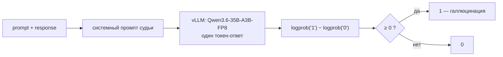

# Guardian of Truth — детектор контекстных галлюцинаций LLM-агента

**Бронза AI Journey Contest 2026** — 51 место из 181 на закрытом лидерборде.

На открытом тесте: **F1 0.4936** (precision 0.369, recall 0.746) — выше бейзлайна организаторов (0.4896).
По полноте решение на уровне первого места: находит 97 галлюцинаций из 130, у лидера 98.

## Задача

Нужен guardrail, работающий как чёрный ящик: на входе — всё, что видел агент поддержки
(системная политика, список инструментов, диалог с клиентом, прошлые вызовы инструментов и их результаты),
и очередной ход агента — сообщение клиенту и/или вызовы инструментов. На выходе — один флаг:
есть в этом ходе галлюцинация (утверждение или действие, не обоснованное контекстом) или нет.

- Данные — диалоги агентов поддержки в четырёх доменах: авиакомпания, интернет-магазин, телеком, банк.
  Политика на английском, диалоги на русском. Контексты длинные: медиана ~30 тыс. символов, максимум ~230 тыс.
- Метрика — F1 по классу «галлюцинация».
- Ограничения: 1× A100 80 ГБ, 30 минут на прогон, архив решения меньше 40 ГБ, без платных API,
  10 успешных сабмитов на команду.

## Решение



Ядро финала — LLM-судья из бейзлайна организаторов: модель читает контекст и ответ и отвечает одним
токеном, `1` или `0`. После недели экспериментов (ниже) ни одна наша доработка ядра на тесте его
не обошла, поэтому в финал пошёл он — с нашей обвязкой:

- **Логит-разность вместо вероятности.** Решение — `logprob('1') − logprob('0') ≥ 0`, что равносильно
  P ≥ 0.5, но без насыщения softmax в 1.0: оценки остаются упорядоченными и пригодными для ранжирования и ансамблей.
- **Кэш префиксов.** Ходы одного диалога отправляются подряд, и vLLM переиспользует уже посчитанный общий контекст.
- **Защита по времени.** После 27-й минуты новые запросы не отправляются, файл ответов пишется в любом случае.
  Если судья оценил меньше половины примеров, скрипт завершается с ошибкой — упавший запуск платформа
  не засчитывает, и попытка не сгорает.
- **Всё внутри архива.** Веса лежат в `model/`, интернет при запуске не нужен.

Вариант **`predict_border.py`**: всё, что помечает судья, остаётся помеченным, а ответы чуть ниже порога
(логит-разность от −1 до 0) дополнительно проверяются в режиме рассуждений с нашим промптом v3. Модель сначала
рассуждает — генерация идёт до `</think>`, но не дольше 2560 токенов, — затем рассуждение закрывается
(принудительно, если упёрлось в лимит) и читаются логиты ответного токена.

## Результаты

| | Помечено | Найдено из 130 | Precision | Recall | F1 |
|---|---|---|---|---|---|
| Бейзлайн организаторов | 254 | 94 | 0.370 | 0.723 | 0.4896 |
| **Наш финал** | 263 | 97 | 0.369 | **0.746** | **0.4936** |
| Первое место | 175 | 98 | 0.560 | 0.754 | 0.6426 |

Порог у финала тот же, что у бейзлайна, поэтому разница между ними (+0.004) — разброс между запусками:
при другом составе батчей GPU выдаёт чуть другие логиты, и несколько пограничных ответов меняют сторону.
Отставание от лидеров целиком в ложных тревогах: 166 против 77 у первого места. Все сабмиты, лаборатории
и их цифры — в [`experiments/README.md`](experiments/README.md).

## Запуск

### Локально

Нужна GPU с ~80 ГБ памяти и vLLM (на платформе — 0.19.1).

```bash
pip install -U huggingface_hub hf_xet
hf download Qwen/Qwen3.6-35B-A3B-FP8 --local-dir solution/model

cd solution
pip install .
python scripts/predict.py --input ../data/valid.parquet --output ../runs/valid_predictions.parquet
```

Вход — CSV или parquet с колонками `id`, `prompt`, `response`; выход — `id`, `label` (0/1),
формат определяется по расширению `--output`.

### Архив для платформы

```bash
bash tools/run_all.sh                     # Linux: скачать веса и собрать dist/final.zip
bash tools/run_all.sh predict_border.py   # то же для варианта с перепроверкой пограничных
```

На Windows — `powershell -ExecutionPolicy Bypass -File tools\run_all.ps1` (параметр `-Entry predict_border.py`).
Если веса уже лежат в `solution/model`, хватит `python tools/build_zip.py solution dist/final.zip`.

### Эксперименты

```bash
python tools/pack_experiment.py experiments/j3_cascade dist/j3_cascade.zip
```

## Структура

```
solution/                          финальное решение, ровно то, что уходит на платформу
├── scripts/predict.py             финал: судья, логит-разность, P ≥ 0.5
├── scripts/predict_border.py      финал + перепроверка пограничных рассуждениями
├── src/hallucination_detector/
│   ├── scoring.py                 судья: один токен (chat) и рассуждение → токен (think)
│   ├── server.py                  запуск и остановка vLLM
│   ├── prompt.md                  промпт судьи
│   └── prompt_v3.md               наш промпт: проверка каждого факта и каждого вызова
├── model/                         сюда кладутся веса (в репозиторий не входят)
└── pyproject.toml
experiments/                       все сабмиты, лаборатории и разведка платформы, с цифрами
tools/
├── build_zip.py                   архив по правилам платформы
├── pack_experiment.py             архив эксперимента из experiments/
├── run_all.sh, run_all.ps1        скачать веса и собрать архив одной командой
docs/cloud_ru.md                   сборка архива на 37 ГБ на облачной машине
```

## Данные, веса и чужой код

- Данные соревнования в репозиторий не входят. Для локального запуска положите `valid.parquet`
  от организаторов в `data/`.
- Веса — [Qwen/Qwen3.6-35B-A3B-FP8](https://huggingface.co/Qwen/Qwen3.6-35B-A3B-FP8), лицензия Apache-2.0.
- `solution/src/hallucination_detector/server.py` и `prompt.md` взяты из бейзлайна организаторов
  без изменений. Остальной код написан нами.

## Команда

**Андрей Пузанов** — на платформе `kihn61696567`
